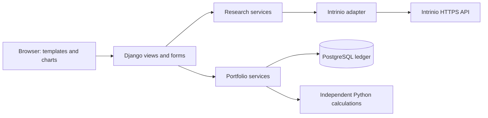

# Repository audit and development plan

Audit date: October 9, 2026. This document records recommendations and verified
observations; it does not claim that the proposed application exists.

The [original specification](product-specification.md) remains the source of
product requirements. The refinements below are explicit recommendations for
implementing it, rather than silent changes to those requirements.

## 1. Current architecture and implemented features

The checkout at `a340f6c` contains only `README.md`. There are no application
modules, dependency manifests, lockfiles, tests, database migrations, CI
workflows, or deployment configuration. The checkout was clean before this
audit. No existing functionality needs to be rewritten.

Verified environment tools include Python 3.12.14, pip 26.2.1, uv 0.12.19,
Git 2.52.0, Node.js 24.19.0, and npm 11.9.0. The checkout matches the remote
`main` commit, and read-only GitHub access works. Node.js is available but is
not required by the recommended first implementation.

No Intrinio-, Django-, Supabase-, or database-related environment variable names
were present at inspection. This audit checked names only and did not read or
print credential values. The onboarding configuration inspected earlier had no
secret bindings. A subscription cannot be inferred from either observation.
The user subsequently supplied the active-plan names recorded in section 4;
this resolves the subscription-name question but not live API verification.

## 2. Minimum recommended stack

Use a modular Django application. This keeps the web application and financial
logic primarily in Python while providing authentication, forms, CSRF
protection, an ORM, and migrations through one established framework.

| Concern | Recommendation | When to introduce it |
| --- | --- | --- |
| Runtime | Python 3.12; pin dependencies with a lockfile | Foundation |
| Web application | Latest supported Django 5.2 LTS patch | Foundation |
| Interface | Django templates; small HTMX enhancements as needed | Search and research pages |
| Interactive prices | Locally served Plotly.js, with chart data prepared in Python | Historical-price page |
| Market-data transport | A small HTTPX client behind a provider interface | First Intrinio integration |
| Persistence | PostgreSQL and Django ORM/migrations | Before persistent user portfolios |
| Authentication | Django sessions and authentication | Before exposing private user records |
| Financial accounting | Python `Decimal`; independent calculation modules | Portfolio work |
| Statistics | NumPy/pandas only when a concrete analytic needs them | Advanced analytics |
| Automated checks | Django's test runner initially; Ruff; browser tests when UI workflows exist | Add alongside the features they validate |
| CI | GitHub Actions for the installed checks | Foundation, then extend per milestone |

Django's official 5.2 release notes designate it as an LTS release and confirm
Python 3.12 compatibility. Resolve and pin the latest maintained 5.2 patch when
implementation starts; do not pin an old patch from memory.

SQLite may support the early local search-only prototype. PostgreSQL is the
target for persistent relational data. SQLite-only tests will not establish
that PostgreSQL constraints, transactions, or concurrent ledger writes work.

React/TypeScript remains an option if the interface later needs extensive
client-side interaction or a separate mobile client. The first MVP does not
justify a second application, a Node build pipeline, Prisma, Zod, or a separate
authentication service. FastAPI is a reasonable alternative for an API-only
product, but would require assembling more of this application's web,
authentication, and persistence infrastructure. Streamlit can support separate
internal research tools later; it is not the proposed multi-user product shell.

Sentry, product analytics, Redis, background workers, and paid hosting are
deferred until a measured requirement justifies them. No paid services,
deployment, branch protections, or external account settings were changed.

### Cost constraint supplied by the user

Use free software and existing paid entitlements wherever practical. Avoid new
recurring charges and external accounts for the MVP. Free software is not a
promise that infrastructure, licensed data, backups, or production operations
will cost nothing.

- Django, PostgreSQL, HTTPX, HTMX, Plotly.js, and the proposed test tools do not
  require a hosted subscription. Review their licenses and pin supported
  versions when they are introduced.
- Run one Django application. Use built-in authentication and the Django ORM;
  do not add Supabase Auth, a separate frontend host, or a paid auth provider.
- Start in the existing development environment. Choose deployment only after
  comparing currently available free tiers and their sleep, persistence,
  backup, resource, and usage limits. Do not promise permanent free hosting or
  introduce a paid service without the user's authorization.
- Reuse the current Intrinio plan. Default to historical/EOD data rather than
  websocket streaming, and do not purchase additional datasets for the MVP.
- Add bounded caching only if the data license permits it. Prefer existing
  application/database facilities over an additional Redis service initially.
- Skip hosted product analytics and monitoring services initially. Use safe
  application logs and basic operational checks; add a free monitoring tier
  only when usage justifies it and its terms have been checked.
- Do not assume GitHub Actions, managed databases, or cloud development have
  unlimited free usage. Keep checks bounded and use existing account quotas.
- Before a cost-bearing choice, document the free alternative, any current
  recurring or usage charge, operational tradeoffs, and an exit path. Costs
  not verified from current terms must be labeled unknown.

### Module boundaries

Suggested layout, to be created incrementally rather than all at once:

```text
config/                    Django configuration and application entry points
market_data/               Provider contracts, Intrinio transport, normalization
research/                  Search and research views, forms, templates
accounts/                  User model and authentication integration
portfolios/                Ledger persistence, authorization, application services
watchlists/                User-owned watchlists
analytics/                 Pure accounting and risk calculations
tests/                     Integration/browser tests and labeled fixtures
docs/                      Definitions, architecture, operating instructions
```



Views should orchestrate services rather than contain financial formulas or
raw provider requests. Analytics should accept explicit inputs and return
results without accessing Django, the database, or the network. This permits
later integration with independent research engines without promising model
performance.

## 3. Missing components and recommended specification improvements

All functional modules in the specification are currently missing. The main
risks are unverified data entitlements, ambiguous financial definitions,
incorrect cash-flow handling, and exposing another user's portfolio records.
Address those before adding advanced visual polish or statistical models.

1. **Bound the first data scope.** Start with daily end-of-day prices for one
   supported market and currency. U.S.-listed USD equities are the recommended
   default given the user-reported U.S. feeds, subject to live verification.
   Do not assume Canadian, global,
   real-time, or FX coverage. Mark unsupported instruments explicitly.
2. **Use stable instrument identifiers.** Store the provider security ID and
   exchange MIC with the ticker. A ticker alone is not a durable identity;
   listings, share classes, and ticker changes must remain distinguishable.
3. **Define a provenance contract.** Carry provider, dataset, currency,
   observation date/time, retrieval time, frequency, adjustment basis,
   completeness, and availability with data. Preserve date-only EOD values as
   dates instead of inventing precise timestamps. Handle incomplete periods
   and market holidays when assessing freshness.
4. **Separate missing values from zero.** Use explicit unavailable states.
   Keep a valid observed zero, and explain why a missing field cannot be
   displayed. Fixtures must never become a production fallback.
5. **Separate price series from accounting prices.** Clearly label raw and
   adjusted charts. Use prices on the same share basis as ledger quantities
   for valuation. Process splits explicitly. Never count a dividend twice by
   combining a dividend-adjusted series with separately credited dividends.
   Verify the provider's adjustment methodology before calling a series
   total-return data.
6. **Specify accounting policy before coding gains.** Use `Decimal` for money,
   quantities, fees, and cost basis, including decimal-preserving JSON parsing.
   Recommend FIFO for the initial research ledger, with the method displayed;
   this is not a tax-reporting claim. Define fee treatment and rounding at
   boundaries. Reject unsupported short positions and ambiguous same-day
   event ordering. Document corrections instead of silently rewriting history.
7. **Make ledger writes safe.** Require transactional writes, deterministic
   event ordering, and idempotency keys scoped to a portfolio. Test duplicate
   submissions and concurrent sells against PostgreSQL. Derived holdings
   must reconcile to ledger events rather than become a competing source of
   truth.
8. **Define performance independently of contributions.** Begin with market
   value and realized/unrealized gains. Add time-weighted or money-weighted
   returns only after defining cash-flow timing, dividends, fees, missing
   valuations, and calculation periods. Do not present deposits as returns.
9. **Make multi-currency an explicit milestone.** Until FX sources and
   conversion policy are verified, prevent unsupported cross-currency totals.
   Keep transaction currency distinct from portfolio reporting currency.
10. **Define fundamental metrics and historical availability.** Record fiscal
    period, units, reporting/publication dates where supplied, and trailing
    versus forward definitions. Do not make historical backtests use
    information that was published later. Forward estimates require a verified
    dataset; do not derive them from unsupported assumptions.
11. **Apply security throughout the roadmap.** Production settings, CSRF,
    secret redaction, input bounds, and provider request limits begin with the
    foundation. Owner-scoped authorization and negative permission tests
    precede private portfolios. Production hardening is not the first security
    milestone. A public research page can still exhaust a paid provider quota.
12. **Control provider cost and failure behavior.** Bound date ranges, page
    counts, request timeouts, and retries. Debounce searches. Respect
    `Retry-After` and a total retry budget; distinguish rate limits from bad
    credentials. Cache only under verified licensing terms. Process-local
    caches and limits must not be represented as global across deployments.
13. **Define completion criteria per part.** Each part needs a user-visible
    workflow, failure behavior, automated checks, and documented limitations.
    Monitoring and optional analytics services must not delay the first useful
    research workflow.

## 4. Intrinio integration feasibility

### User-reported active plans

The user supplied the following account information during the audit:

| Active plan or included feed | Reported details | MVP decision |
| --- | --- | --- |
| US Fundamentals and Stock Prices | Individual, yearly | Reuse this existing plan; no new data purchase proposed |
| U.S. Fundamentals | Daily | Intended source of reported financial metrics |
| U.S. Historical Stock Prices | Daily | Intended source for the initial historical chart |
| U.S. EOD Index Levels | Daily | Candidate for later benchmark comparisons after methodology checks |
| 15-Minute Delayed CBOE | 15-minute delay | Optional later quote display, labeled delayed |
| IEX Real-Time Stock Prices | Account also lists "IEX Delayed Websocket" | Defer streaming; verify feed-specific freshness before any live label |
| CBOE One | Account also lists "BATS Grandfathered" | Existing entitlement reported; no streaming dependency for the MVP |

These are user-reported account entitlements, not authenticated API results.
They support proceeding with a U.S. historical-price/fundamentals MVP, while
the key, endpoint-level access, limits, and licensing remain unverified. In
particular, an Individual plan must not be assumed to permit a public
multi-user product, redistribution, or indefinite caching. Verify those rights
before exposing the application beyond its permitted audience. Mixed real-time
and delayed account labels must not be flattened into a promise of live data.

### What was verified

Direct requests to `docs.intrinio.com` and `api-v2.intrinio.com` were rejected by
the environment's egress proxy with CONNECT HTTP 403. The API probe contained
no credentials. This is evidence of a network policy blocker, not evidence
that Intrinio rejected an API key or that a subscription is absent.

Official Intrinio SDK documentation and source were accessible through GitHub:

| Capability | Documented evidence | Account-level status |
| --- | --- | --- |
| Search by ticker/name | `GET /securities/search`, text query searches both fields | Not verified |
| Resolve security metadata | Documented security model includes provider ID, currency, MIC, listing and delisting information | Field availability in actual responses not verified |
| Daily historical prices | `GET /securities/{identifier}/prices`, described as EOD; accepts dates and pagination | Included feed reported by user; endpoint access/history depth not verified |
| Adjusted price fields | StockPrice model documents adjusted OHLC/volume, dividends, splits, and incomplete-period flag | Complete methodology and observed behavior not verified |
| Company fundamentals | `GET /companies/{identifier}/fundamentals` | Included feed reported by user; endpoint access/coverage not verified |
| Standardized financials | `GET /fundamentals/{id}/standardized_financials` | Included feed reported by user; endpoint access/metrics not verified |
| API host and authentication | SDK configuration uses `https://api-v2.intrinio.com` and an `api_key` query parameter | No authenticated request executed |

The endpoint names make the intended MVP technically plausible. They do not
prove what this account may retrieve, redistribute, display, or cache.

The documented query-parameter authentication requires particular care: log
redaction must cover request URLs, errors, HTTP client instrumentation, and
monitoring breadcrumbs. All calls remain backend-only. Do not copy SDK examples
that print full responses into production logging, and do not send authenticated
URLs to the browser.

### Gate before live-data acceptance

- Use the subscription/dataset names supplied above and securely configure the
  required API key. Do not request the already supplied plan names again.
  Never put a key in chat, source control, fixtures, or documentation.
- Permit `api-v2.intrinio.com` for runtime calls and `docs.intrinio.com` for
  reference checks in environment settings, preserving existing allowed hosts.
  These settings were not changed during this audit.
- Use existing proxy-backed credentials through their supported HTTPS route
  when available; do not assume a proxy binding is a raw local secret.
- Run a small read-only search, resolve a returned security ID, and request a
  bounded price range. Record statuses and metadata without credentials.
- Verify actual search/metadata response shapes, pagination, ordering, missing
  values, currencies, date semantics, and price adjustment fields.
- Confirm dataset coverage, freshness, quotas, pricing, display/redistribution
  rights, and retention/caching terms from the subscription documentation.
- Verify fundamentals separately. Exclude unavailable metrics rather than
  silently substituting another source or simulated data.

Development with labeled deterministic fixtures can proceed independently,
but fixture-based tests do not satisfy this live-data gate.

### Official references inspected

- [Intrinio Python SDK endpoint catalogue](https://github.com/intrinio/python-sdk/blob/master/README.md)
- [Intrinio security endpoint documentation](https://github.com/intrinio/python-sdk/blob/master/docs/SecurityApi.md)
- [Intrinio security metadata model](https://github.com/intrinio/python-sdk/blob/master/docs/Security.md)
- [Intrinio price data model](https://github.com/intrinio/python-sdk/blob/master/docs/StockPrice.md)
- [Intrinio API configuration/authentication](https://github.com/intrinio/python-sdk/blob/master/intrinio_sdk/configuration.py)
- [Django 5.2 release notes](https://github.com/django/django/blob/stable/5.2.x/docs/releases/5.2.txt)

## 5. Prioritized roadmap

Build parts in order, with small reviewable tasks inside each part. Implement
one complete path through a feature before expanding its breadth.

| Part | Deliverable | Acceptance evidence |
| --- | --- | --- |
| 0: Audit | This architecture, feasibility assessment, and roadmap | Repository inspection and verified source references; unknowns explicit |
| 1: Foundation | Django project, configuration, environment example, dependency lock, test/CI entry points | Fresh install; configuration failure tests; framework checks and initial tests pass |
| 2: Research MVP | Server-side Intrinio adapter, ticker/name search, instrument details, daily chart, entitled basic financials | Mocked integration/failure tests; bounded authenticated provider checks; browser search-to-chart workflow |
| 3: Private portfolios | Authentication, PostgreSQL migrations, transaction ledger, positions, gains, allocations, watchlists | Owner isolation; database/concurrency and accounting tests; browser create-portfolio/add-transaction workflow |
| 4: Analytics | Validated cash-flow-aware performance, volatility, drawdown, benchmarks; correlation/beta/Sharpe only with complete prerequisites | Hand-checked reference cases; missing-data and period-alignment tests; documented definitions and inputs |
| 5: Operations | Deployment configuration, backups/restore, monitoring if justified, global quotas, measured performance improvements | Deployment and recovery checks in the authorized target; security and load checks appropriate to usage |

Part 2 should itself be divided into adapter/search, security details, historical
chart, and fundamentals tasks. Part 3 should separate authentication and owner
isolation, basic ledger, corporate actions, valuation, and watchlists. This keeps
each change reviewable and avoids one large implementation.

Commercial features require a separate explicit decision. Trading/brokerage
execution is outside the scope. Advanced factor models, simulations, and
research engines wait until basic data and portfolio accounting are trustworthy.

## 6. First small, independently testable implementation task

**Objective:** Create the Python/Django foundation with validated configuration
and an explicit unavailable-provider state. Do not implement all product
modules or introduce live fixtures into the interface.

Proposed changes:

- Add `pyproject.toml`, a frozen dependency lock, safe ignore rules, and a
  `.env.example` containing variable names and empty secret placeholders.
- Create Django entry points and development/production configuration. Include
  an initial user model before the first persistent schema, so authentication
  does not require an avoidable user-model migration later.
- Add a basic landing page describing the current availability of research.
  A missing Intrinio key must produce a clear disabled/unavailable state,
  never pretend that live research is working.
- Add safe configuration tests and the first CI command. Add startup and test
  instructions with their working directories.

Acceptance checks:

1. Install from the lock in an isolated environment and run Django checks.
2. Start the development server and request the landing page. Verify the
   explicit unavailable-data state without provider credentials.
3. Verify production startup refuses missing required security configuration
   and does not disclose sensitive values in the resulting errors.
4. Verify the page and configuration behavior with automated tests. Confirm
   test counts and command exit status.
5. Confirm ignored local configuration does not appear in tracked changes and
   that no secret values are committed or returned to the browser.

This task can be completed without a paid service or provider access. It proves
the foundation, not stock research, portfolio accounting, or deployment. The
next task is the typed provider boundary and stock-search workflow, tested
against labeled fixtures and later against entitled live data.

## 7. Code breakdown and commentary conventions

- Use focused modules with descriptive names and explicit inputs/outputs.
- Keep transport, normalization, application services, persistence, and
  calculations separate without introducing a framework for every layer.
- Explain financial assumptions, adjustment choices, rounding rules, and
  non-obvious decisions in docstrings or nearby comments. Avoid comments that
  merely repeat a Python statement.
- Add deterministic tests with each important behavior, including negative and
  missing-data cases. Keep fixtures clearly labeled and out of production paths.
- Explain substantial decisions in progress updates and short decision notes.
- Finish each task with Objective, Changes, Files, Tests, Limitations, and one
  highest-priority Next Step. Separate implemented results from proposed work.

## 8. Audit outcomes and limits

Repository and tool inspection succeeded. Official GitHub source-reference
checks succeeded. Direct Intrinio and Django documentation website access was
blocked by network policy; official GitHub sources provided the evidence used
above. No API keys were inspected, no authenticated provider calls ran, and no
subscription capabilities or licensing terms were verified through live calls.

## Implementation update — October 10, 2026

The original audit above describes the starting checkout. Foundation, search,
instrument references, and bounded daily-price charts are now implemented;
see [the changelog](../CHANGELOG.md) for verified results and remaining work.

The first chart uses Python-generated SVG with a small locally served point
inspection script and a keyboard-accessible table. This replaces the initial
Plotly recommendation for this simple daily-close view: it needs no additional
package, CDN, or Node build. Dates and raw/adjusted basis are explicit form
controls. Consider a plotting library when richer interactions justify it.

Historical-price access and one-year AAPL charts have passed live checks. The
application now has 995 automated tests passing on PostgreSQL. Explicit-period income, balance-sheet,
and cash-flow statements have also passed live AAPL 2025 FY browser checks,
including a restated balance sheet. See [fundamentals](fundamentals.md).
Django registration, sign-in/out, password changes, and the current-user account
boundary now pass automated and desktop/mobile browser checks. See
[authentication](authentication.md). Private USD portfolio metadata is now
implemented on PostgreSQL with owner isolation, database constraints, concurrent
creation/allowance tests, and two-user desktop/mobile browser checks. See
[portfolios](portfolios.md). The [USD ledger](ledger.md) is also implemented,
with prefix-balance checks, immutable entries, duplicate-submit protection,
and real PostgreSQL concurrency tests. [FIFO positions/cost basis/gains](fifo.md)
now pass hand-calculated and browser checks without provider calls. Corporate
actions now support manually recorded net dividends and exact per-lot splits;
see [action rules](corporate-actions.md). [Market valuation/unrealized gains](valuation.md)
are implemented with explicit price dates, share-basis checks, and unknown totals
for missing closes. [Cash-inclusive allocation weights](allocations.md) are now
implemented with reconciled rounding and unknown weights for incomplete or zero
totals. [Time-weighted performance](performance.md) now supports confirmed end-of-day
flows with bounded requests and explicit unavailable states. Private
[watchlists](watchlists.md) now provide owner-only instrument bookmarks and removal.
Explicit [journal corrections](corrections.md) are now implemented with previews
and permanent audit history. Bounded [daily session returns](daily-returns.md), observed [volatility/drawdown](risk.md) and aligned [benchmark comparisons](benchmarks.md) are implemented. [Correlation and beta](relationships.md) are implemented. [Sharpe](sharpe.md) is implemented. [Selected-period profitability](profitability.md) is implemented. [Annual return on assets/equity](capital-returns.md) is implemented. [Annual revenue and earnings growth](growth.md) is implemented. [Selected-FY basic/diluted P/E](multiples.md) is implemented. [Annual statement trends](trends.md) are implemented. [Stock volatility and drawdown](stock-risk.md) are implemented. [Daily trading volume](volume.md) is implemented. [Dated provider-reported company market capitalization](market-capitalization.md) is implemented; underlying price/share-count dates remain unavailable from this feed. [Watchlist market information and saved per-list preferences](watchlist-market.md) are implemented. Connected account and bounded live research [acceptance](release-acceptance.md) now pass, including a correction to exact Intrinio profit tags. [Release safeguards](release-safeguards.md) now add production shared quotas, configuration/CI checks and a tested [backup/restore](backups.md) drill. Next: private deployment with a low-cost host and verified TLS/storage/rights. Wider coverage,
account quotas, caching/display rights, wider analytics and
production deployment remain separate work.
Subscription names and included feeds were supplied by the user and recorded
above, with no additional dataset purchases proposed.

The original audit task added planning documentation only. At that time no
application code, dependencies,
database, CI workflow, deployment, or reusable installation/startup configuration
had been implemented, and there was no application test suite to execute.
Subsequent implementation and verification are described above and in the changelog.


## Production-runtime update — October 11, 2026

[Version 0.31 serving/private access](production-serving.md) is implemented and
independently tested with Gunicorn and compressed static assets. Production is
private by default, registration is closed, and a process-only health endpoint
avoids keeping a free database awake. Render remains a conditional candidate:
its live terms require the saved docs.render.com network addition to be applied.
No hosted deployment or cost is claimed. Next: verify the actual Free terms,
then complete the selected target's configuration, access, TLS and backups.

## Deployment-draft update — October 12, 2026

The [Render + Neon review draft](render-deployment.md) now includes a commented
Free-service template and a native build verified in fresh and repeated synthetic
production environments. Actual serving smoke using those runtime packages passes.
No provider call, source publication, host resource or charge occurred; the app
remains v0.31. The earlier documentation addition is applied, but its URL redirects
to `render.com`, which needs the additional saved domain reviewed/published.
Current terms/schema remain unverified. The remaining private-deployment work
includes accounts, source publication, database TLS/roles, initial user, encrypted
backup scheduling and hosted acceptance; these are separate verifiable steps
inside the final deployment work package, not an assertion that launch is complete.

## Verified hosting candidate — October 12, 2026

Render documentation access is now working. Current Free terms/pricing and its
official schema are verified; the [comparison](free-hosting-comparison.md) and
[deployment draft](render-deployment.md) record the evidence and remaining limits.
The template now uses manual deployment and disables automatic previews.
This remains a personal prototype candidate: Render's documentation advises
against production Free use, and external database/API traffic can cause
suspension. No expiring Render Free database is proposed for portfolio records.

The documentation/network blocker is resolved. Next establish Render/Neon Free
accounts and secure access, then complete authorized source publication,
database roles/TLS and ingress validation, initial account provisioning,
encrypted off-machine backups and hosted acceptance. No host resource or cost
has been introduced. The application stays v0.31; local workflow/readiness and
official-schema validation pass without a new full-suite run.
